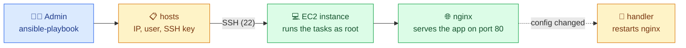

# Exercise 1 — Ansible: configure the server

Installs nginx on the server created by [../terraform](../terraform), copies the Angular app onto it and configures nginx to serve it on port 80. Ansible connects over SSH: nothing to install on the server.



## What the playbook does

| Task | Module | Result on the server |
|---|---|---|
| Install nginx | `apt` | nginx installed and running |
| Copy the Angular app | `copy` | `/var/www/html/olympic-games-starter/`, owned by root, read-only for nginx |
| Deploy the nginx site config | `copy` | `nginx/app.conf` in `/etc/nginx/conf.d/` |
| Disable the default nginx site | `file` | Ubuntu's welcome site off (it also claims `default_server` on port 80) |
| handler: Restart nginx | `service` | runs once, at the end, only if one of the two config tasks changed something |

The playbook is idempotent: a second run reports `changed=0` and does not restart nginx.

## Prerequisites

| What | How |
|---|---|
| ansible-core `2.21.6` | `pipx install "ansible-core==2.21.6"` |
| A running instance | `terraform apply` in [../terraform](../terraform) |
| Its public IP in `hosts` | `terraform output -raw public_ip`, copied into `ansible_host` (changes at each apply) |
| SSH key | `~/.ssh/id_ed25519_aws`; connect once by hand to accept the host fingerprint |

## Usage

From this folder:

```bash
ansible all -i hosts -m ping                          # expected: my-vm | SUCCESS, "ping": "pong"
ansible-playbook -i hosts --syntax-check deploy.yml   # expected: playbook: deploy.yml
ansible-playbook -i hosts deploy.yml                  # first run on a new instance: ok=6 changed=5
ansible-playbook -i hosts deploy.yml                  # second run: ok=5 changed=0, no handler
```

Add `-v` (or `-vvv` for SSH details) to debug a failing run.

## Check

| Check | Expected |
|---|---|
| `http://<public_ip>` | "Olympic games app" and the list of countries |
| `http://<public_ip>/foo` | the app's "No corresponding page found" page, not an nginx 404 |
| `curl -I http://<public_ip>/` | `Cache-Control: no-cache` (HTML is never cached) |
| `curl -I http://<public_ip>/main.<hash>.js` | `Cache-Control: max-age=31536000` (fingerprinted files cached one year) |

If the page does not load: `systemctl status nginx` and `sudo nginx -t` on the server, then compare `/etc/nginx/conf.d/app.conf` with `nginx/app.conf`.

## Files

| File | Content |
|---|---|
| `hosts` | inventory: the server's address and how to log in |
| `deploy.yml` | the playbook |
| `nginx/app.conf` | nginx site for the app (starter kit file, fixed and commented) |
| `app/olympic-games-starter/` | the compiled Angular app (starter kit, not built here) |

Every block is preceded by a comment saying what it is for, and a link to its official documentation. Design choices: [docs/decisions.md](../../docs/decisions.md).
