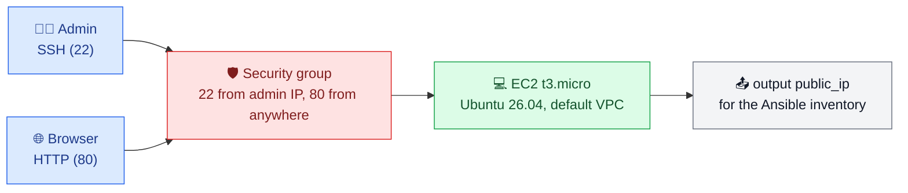

# Exercise 1 — Terraform: provision the server

Creates an Ubuntu server on AWS EC2, reachable over SSH from the admin IP only and over HTTP from anywhere. Ansible configures it next ([../ansible](../ansible)).



## What it creates

| Block | Role |
|---|---|
| `aws_key_pair` | registers the admin's existing **public** key; the private key never leaves the laptop |
| `aws_security_group` + 3 rules | firewall: SSH from the admin IP, HTTP from anywhere, all outbound (apt) |
| `data "aws_ami"` | reads the latest Ubuntu 26.04 LTS image published by Canonical (no hard-coded AMI ID) |
| `aws_instance` | the `t3.micro` server (Free plan eligible in `eu-north-1`) |
| `output "public_ip"` | the address to put in the Ansible inventory |

Network: the region's **default VPC** (public subnets, internet gateway). The state lives in S3, key `01-provision-configure/terraform.tfstate`.

## Prerequisites

| What | How |
|---|---|
| Terraform `~> 1.17` | official package |
| AWS session | `aws login` (no long-lived access key) |
| State bucket | created once by [../../00-bootstrap](../../00-bootstrap) |
| SSH key pair | `~/.ssh/id_ed25519_aws` and `~/.ssh/id_ed25519_aws.pub` |
| Admin IP | `terraform.tfvars` (git-ignored), one line: `admin_cidr = "<your IP>/32"`, IP from `curl -s https://checkip.amazonaws.com` |

## Usage

```bash
terraform init       # downloads the AWS provider, connects the S3 backend
terraform validate   # expected: Success! The configuration is valid.
terraform plan       # expected on a fresh start: Plan: 6 to add
terraform apply
ssh -i ~/.ssh/id_ed25519_aws ubuntu@$(terraform output -raw public_ip)
```

The public IP changes every time the instance is recreated: read it again with `terraform output public_ip`.

## End of every session

```bash
terraform destroy
```

Then check that nothing is left: EC2 console (instance *Terminated*), or *Resource Groups & Tag Editor*, search tag `Project = devops-iac-aws-lab` (only the state bucket should remain).

## Files

| File | Content |
|---|---|
| `terraform.tf` | Terraform and provider versions (exact versions in `.terraform.lock.hcl`) |
| `providers.tf` | AWS region and default tags |
| `backend.tf` | where the state lives (S3) |
| `variables.tf` | `admin_cidr` (value in `terraform.tfvars`) |
| `main.tf` | key pair, security group, AMI lookup, instance |
| `outputs.tf` | `public_ip` |

Every block is preceded by a comment saying what it is for, and a link to its official documentation. Design choices: [docs/decisions.md](../../docs/decisions.md).
