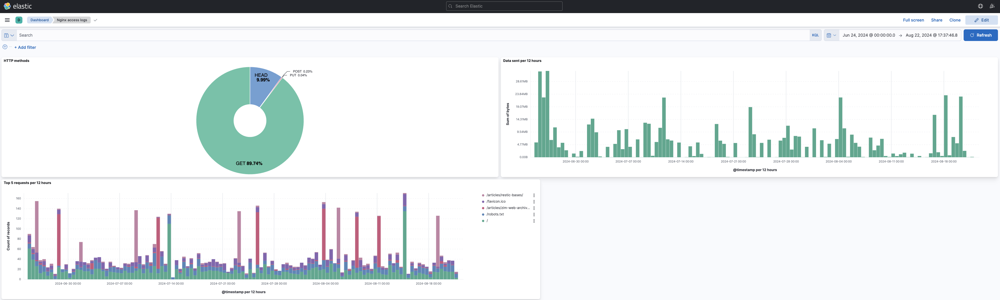
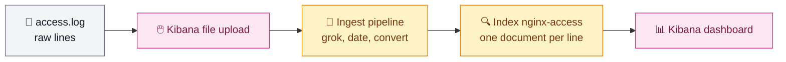

# Exercise 2 — Observability with the Elastic Stack

Load a real nginx access log into Elasticsearch, then build a Kibana dashboard of three charts. Runs locally with Docker Compose (see [decisions](../docs/decisions.md)).



| Path | Content |
|---|---|
| [docker/docker-compose.yml](./docker/docker-compose.yml) | Elasticsearch and Kibana 7.17.29, single node, ports bound to `127.0.0.1` |
| [samples/nginx-access.log](./samples/nginx-access.log) | 14,496 lines in nginx *combined* format, June to August 2024 |
| [kibana/nginx-access-dashboard.ndjson](./kibana/nginx-access-dashboard.ndjson) | dashboard export: index pattern and the three charts |
| [screenshots](./screenshots) | the deliverables: full dashboard, then each chart |
| [analysis.md](./analysis.md) | what the logs say: four findings, each replayable in Kibana |

## How it works



There is no Logstash: the Kibana file upload creates an ingest pipeline (`nginx-access-pipeline`) that parses each line inside Elasticsearch. Its `grok` processor splits the line with the `%{COMBINEDAPACHELOG}` pattern (nginx reuses Apache's *combined* format), `date` turns the timestamp into `@timestamp`, and `convert` makes `bytes` and `response` numbers.

## Run

Requires Docker Desktop with about 4 GB of memory.

1. **Start the stack**

   ```bash
   cd 02-observability-elk/docker
   docker compose up -d
   curl localhost:9200          # "number" : "7.17.29"
   ```

   Kibana answers at http://localhost:5601 one or two minutes later.

2. **Load the log file.** Kibana home → *Upload a file* → `samples/nginx-access.log` → *Import* → *Advanced* tab:
   - index name: `nginx-access`;
   - add `"number_of_replicas": 0` to the index settings (a single node cannot hold a replica: the cluster would turn yellow);
   - untick *Create index pattern*: the dashboard export brings its own.

   Expected: 14,496 documents ingested.

3. **Allow 12-hour bars.** *Stack Management* → *Advanced Settings* → `histogram:maxBars` = `200`. The default (100) is lower than the 118 twelve-hour buckets of the period, and Kibana silently widens the interval to one day. This setting is not part of the export.

4. **Import the dashboard.** *Stack Management* → *Saved Objects* → *Import* → `kibana/nginx-access-dashboard.ndjson`, then open *Nginx access logs*. Its time range (24 June to 22 August 2024) is saved with it.

5. **Clean up**

   ```bash
   docker compose down -v       # -v also deletes the volume: index and dashboard
   ```

## Charts

| Chart | Lens settings |
|---|---|
| HTTP methods (donut) | slice by the top 5 values of `verb`, size by count |
| Data sent per 12 hours (bar) | `@timestamp` with a 12-hour interval; sum of `bytes`, *Bytes (1024)* format |
| Top 5 requests per 12 hours (stacked bar) | `@timestamp` with a 12-hour interval; count, broken down by the top 5 values of `request`, "Other" group off |
