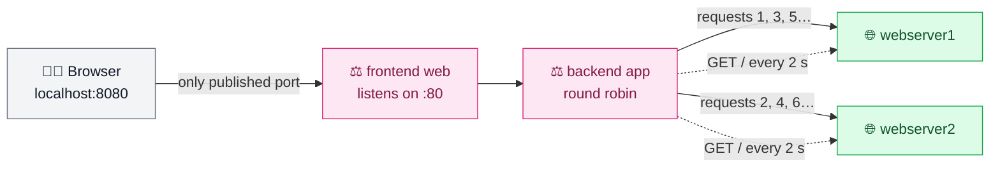

# Exercise 3 — Load balancing with HAProxy

One HAProxy in front of two instances of the `nginxdemos/hello` demo app: it spreads requests in turn, probes each server, takes a failed one out and brings it back without manual action. Runs locally with Docker Compose (see [decisions](../docs/decisions.md)).

| Path | Content |
|---|---|
| [docker/haproxy.cfg](./docker/haproxy.cfg) | the deliverable: frontend, round robin backend, HTTP health checks |
| [docker/docker-compose.yml](./docker/docker-compose.yml) | HAProxy 3.4 and two `nginxdemos/hello:0.4`, only HAProxy published, on `127.0.0.1:8080` |
| [docker/failover-test.log](./docker/failover-test.log) | HAProxy log of the failover test below |

## How it works



The three containers share the network Compose creates by default; HAProxy reaches the servers by their service name (`webserver1:80`), resolved by Docker's embedded DNS. The web servers publish no port: the browser only ever talks to HAProxy.

| Setting | Effect |
|---|---|
| `option httpchk` + `http-check expect status 200` | a server is healthy if `GET /` answers 200, not just if its port is open |
| `check inter 2s fall 3 rise 2` | probe every 2 s; out after 3 failures, back after 2 successes. One missed probe is not enough to remove a healthy server |
| `resolvers docker` | names are resolved again at runtime: a restarted container may get a new IP address |
| `timeout connect 1s`, `retries 2`, `option redispatch` | a request sent to a server that just stopped is retried on the other one after about 1 s, while the health checks have not yet noticed |

## Run

```bash
cd 03-load-balancing/docker
docker compose up -d
docker compose exec haproxy haproxy -c -V -f /usr/local/etc/haproxy/haproxy.cfg   # Configuration file is valid
```

Open http://localhost:8080 and refresh: *Server name* and *Server address* alternate between the two containers. After editing `haproxy.cfg`, apply it with `docker compose restart haproxy`.

## Failover test

1. Terminal 1, send traffic (one request every 0.5 s, HTTP code only):

   ```bash
   while true; do curl -s -o /dev/null -w "%{http_code} " localhost:8080; sleep 0.5; done
   ```

2. Terminal 2: `docker compose stop webserver1`, wait about 15 s, then `docker compose start webserver1`.
3. Save the trace: `docker compose logs --no-log-prefix --since <test start time> haproxy > failover-test.log`.

What [failover-test.log](./docker/failover-test.log) shows (three scenarios):

| Scenario | Log | Reading |
|---|---|---|
| webserver1 stopped ~12 s | `app/web2 0/1006/1/0/1008 200`, then `web1 is DOWN`, then `web1 is UP` | requests meant for web1 lose about 1 s and are served by web2: no error. Before `timeout connect 1s` and `option redispatch`, they hung 10 to 15 s |
| webserver2 stopped ~9 s | `app/web1 0/1004/... 200`, no `DOWN` line | the outage is shorter than detection (~8 s); redispatch absorbs it alone |
| both stopped | `503 sC--`, then instant `app/<NOSRV> 503`, then each server back `UP` | nobody left: 503 is unavoidable, but immediate once both are marked down; recovery is automatic |

Detection takes about 8 s rather than the theoretical 6 s: a stopped container leaves the network, so each probe waits its full 2 s before failing (`Layer4 timeout`).

## Clean up

```bash
docker compose down -v --remove-orphans
```
